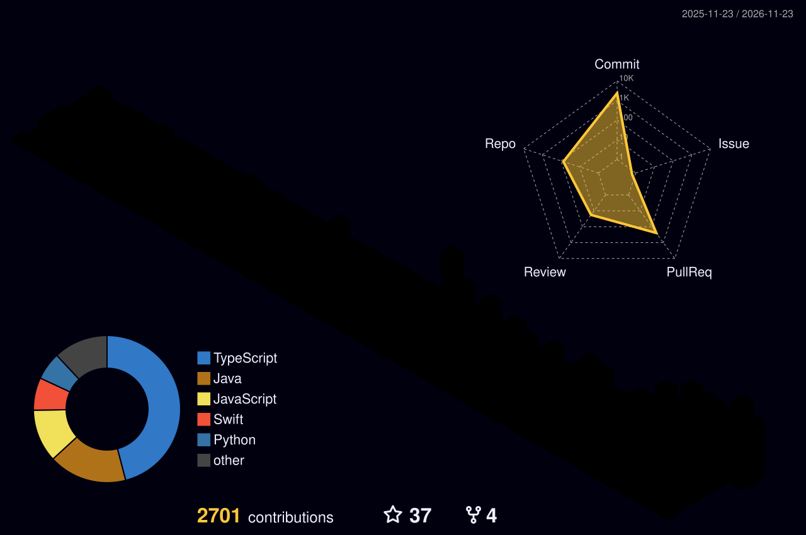

  

  
  
  

---

### 🛠️ What I build

I run **PandaScript**, a small freelance shop. Most of my work is edge backends on Cloudflare Workers, extensions for the Pterodactyl panel, and Minecraft server tooling. I also make iOS apps and self-host most of what I use.

### 📌 Featured

| Project | What it does | Stack |
|---|---|---|
| [**pterodactyl-panel-mcp**](https://github.com/jackh54/pterodactyl-panel-mcp) | An MCP server that runs inside the Pterodactyl panel, so Claude, ChatGPT or Cursor can manage your servers | PHP |
| [**pterodactyl-panel-passkeys**](https://github.com/jackh54/pterodactyl-panel-passkeys) | Passkey sign-in for Pterodactyl (Face ID, Touch ID, Windows Hello) | PHP · WebAuthn |
| [**cirrus-mail**](https://github.com/jackh54/cirrus-mail) | A self-hosted email suite that runs on your own Cloudflare account | TypeScript · Workers · D1 · R2 |
| [**VelocityShield**](https://github.com/jackh54/VelocityShield) | Detects and blocks VPNs on Velocity proxies | Java |
| [**VoiceSentinel**](https://github.com/jackh54/VoiceSentinel) | Voice chat moderation for Minecraft | Python |
| [**crawlytree**](https://github.com/jackh54/crawlytree) | A web crawler | Python |

### ⚙️ Stack

  

### 📈 Activity

  

  

